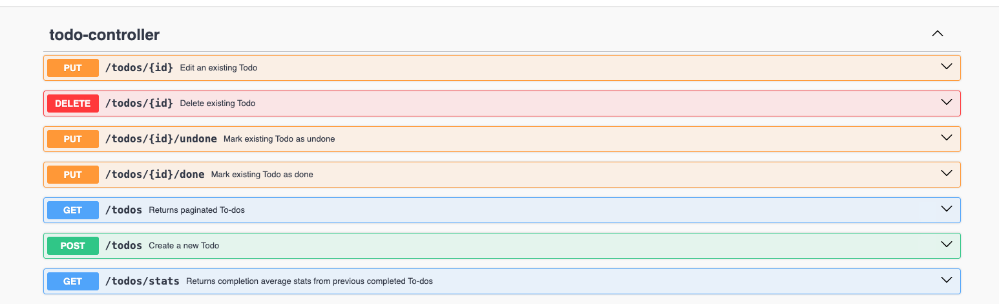

# Todo App

Implementation of a simple yet useful application for organizing incoming activities. This repo includes a client-agnostic REST API created using Spring Boot.

## Table of Contents

- [Caveats](#caveats)
- [Endpoints](#endpoints)
- [Features](#features)
- [Prerequisites](#prerequisites)
- [Installation](#installation)
- [Usage](#usage)
- [Testing](#testing)
- [Technologies Used](#technologies-used)
- [Architecture](#architecture)
- [Contributing](#contributing)
- [License](#license)

## Caveats

This application is using in-memory storage for data. No persistence layer is configured, meaning all data will be lost upon application restart.

## Endpoints

These are the endpoints implemented by the current version of the project.



## Features

- Create Todo (Text, Priority, Due Date)
- Update Todo (Text, Priority, Due Date)
- Update Todo Status (Done/Undone)
- Delete Todo
- Get Todos (Paginated, Sorted, and Filtered)
- Show real-time completion stats
- OpenAPI documentation for easy API exploration

## Prerequisites

There's no need for a specialized IDE for this project. However, since the development was done using IntelliJ IDEA, using it is highly recommended.

The needed software to run this project is:

- OpenJDK 17+
- Maven 3.9+

## Installation

Please ensure that you have the software requirements as mentioned in [Prerequisites](#prerequisites).

Instructions to get your project up and running locally (UNIX-like systems):

1. Clone the repository:
   ```bash
   git clone https://github.com/ernestorbemx/TodoApp.git
   ```
2. Change directory to the cloned project folder:
   ```bash
   cd TodoApp
   ```
3. Run the Maven script:
   ```bash
   ./mvnw spring-boot:run
   ```
4. Navigate to `http://localhost:9090/swagger-ui/index.html#/` to explore the API.
5. Done!

## Usage

This is a simple REST API. You can use your favorite HTTP client (e.g., Postman, cURL) to interact with it.

### Example cURL Command

```bash
curl -X POST http://localhost:9090/todos \
-H "Content-Type: application/json" \
-d '{"text": "Sample Todo", "priority": "HIGH", "dueDate": "2023-12-31T23:59:59"}'
```

## Testing

After following the [installation instructions](#installation), you can run the tests using the following command:

```bash
./mvnw test
```

## Technologies Used

- **Spring Boot**: For building the REST API.
- **H2 Database**: In-memory database for development and testing.
- **Spring Data JPA**: For data access and repository management.
- **Lombok**: To reduce boilerplate code.
- **OpenAPI (Swagger)**: For API documentation.
- **JUnit & Mockito**: For unit and integration testing.

## Architecture

The application follows a layered architecture:

1. **Controller Layer**: Handles HTTP requests and responses.
2. **Service Layer**: Contains business logic.
3. **Repository Layer**: Manages data access using Spring Data JPA.
4. **Model Layer**: Defines the data structure (entities).
5. **DTO Layer**: Contains Data Transfer Objects for API communication.

### Diagram

```
[Client] --> [Controller] --> [Service] --> [Repository] --> [Database]
```

### Key Components

- **TodoController**: Exposes REST endpoints.
- **TodoService**: Implements business logic for managing Todos.
- **TodoRepository**: Provides CRUD operations and custom queries.
- **TodoFilter**: Enables filtering, sorting, and pagination.

## Contributing

Contributions are welcome! To request changes, first open an issue.

When developing changes, please:

1. Fork the repository.
2. Create your feature branch:
   ```bash
   git checkout -b feature/FeatureName
   ```
3. Commit your changes:
   ```bash
   git commit -m 'Add some feature'
   ```
4. Push to the branch:
   ```bash
   git push origin feature/FeatureName
   ```
5. Open a Pull Request.

## License

This project is licensed under the [Apache License 2.0](https://www.apache.org/licenses/LICENSE-2.0).
